<p align="center">
  <a href="https://longtao.fun"></a>
</p>

<p align="center">
  <a href="https://longtao.fun"><b>🌐 Interactive 3D profile</b></a> ·
  <a href="https://github.com/eust-w?tab=repositories">All repos</a> ·
  <a href="https://github.com/eust-w/opengeniemaster">OpenGenieMaster</a>
</p>

> **Building tools for robotics data, Real2Sim, simulation, and agent-driven engineering & scientific research.**
> 构建机器人数据、Real2Sim、仿真，以及由 Agent 驱动的工程与科研工具。

```
Real ──► 3DGS ──► Sim ──► Policy ──► Agent ──► (memory · reflect) ──┐
 ▲                                                                   │
 └───────────────────────── evidence · eval · bench ◄────────────────┘
```

## 🤖 Embodied Intelligence

| Project | What it is |
|---|---|
| [**opengeniemaster**](https://github.com/eust-w/opengeniemaster) | Open-source embodied agent harness — EEP over MCP, safety interlocks, versioned memory, semantic multi-robot simulator |
| [amd-bigym-3dgs-rocm](https://github.com/eust-w/amd-bigym-3dgs-rocm) | 3DGS kitchen shell for BiGym / MuJoCo reproduced on AMD ROCm (W7900D verified) |
| [amd-bigym-openpi-eval](https://github.com/eust-w/amd-bigym-openpi-eval) | OpenPI (JAX) + BiGym + MuJoCo + 3DGS evaluation with 3-camera recording |
| [WorldSpec](https://github.com/eust-w/WorldSpec) | Canonical world semantics, evidence & validation → multi-simulator compilation |
| [robodata](https://github.com/eust-w/robodata) · [open-embodied-simops](https://github.com/eust-w/open-embodied-simops) | Dataset conversion / QA / segmentation · simulation workflow workbench |

## 🧊 Real2Sim & 3D Gaussian Splatting

[real2simcapture](https://github.com/eust-w/real2simcapture) (iPhone ARKit → MJCF/URDF/USD) · [images23dgs](https://github.com/eust-w/images23dgs) · [gsstudio-public](https://github.com/eust-w/gsstudio-public) · [Real2Motrix](https://github.com/eust-w/Real2Motrix) · [real2sim-platform](https://github.com/eust-w/real2sim-platform) · [shanghai-city-digital-twin-plan](https://github.com/eust-w/shanghai-city-digital-twin-plan)

## 🔁 AI4AI — agents that build, verify and evolve agents

| Project | What it is |
|---|---|
| [agentic-embedded-lab](https://github.com/eust-w/agentic-embedded-lab) | Agent-native embedded lab: pluggable simulation, evidence-driven validation, controlled evolution |
| [open-robotics-plugin](https://github.com/eust-w/open-robotics-plugin) | Robotics skills for Claude Code / Codex / Gemini CLI / Cursor |
| [CSNative](https://github.com/eust-w/CSNative) | Provider routing & custom models for Claude Science (Go + Wails) |
| [kakashi](https://github.com/eust-w/kakashi) · [codex-dispatch](https://github.com/eust-w/codex-dispatch) · [actor-map](https://github.com/eust-w/actor-map) · [superscience](https://github.com/eust-w/superscience) | Capability fusion · task queues · requirement maps · research workbench |
| [cityagent-public](https://github.com/eust-w/cityagent-public) | LoRA + W8A8 quantization, evidence-backed extraction |

## 🛠 Stack

         

